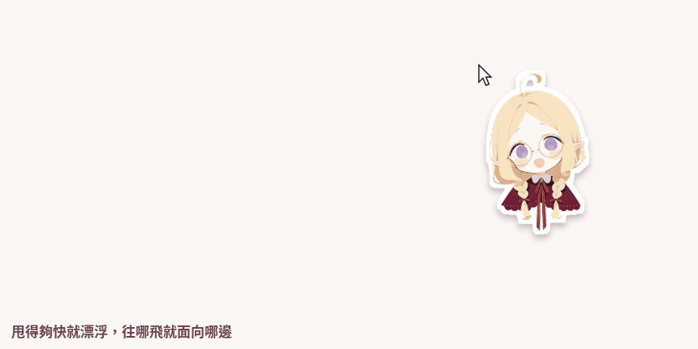
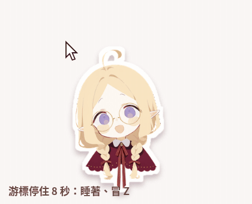
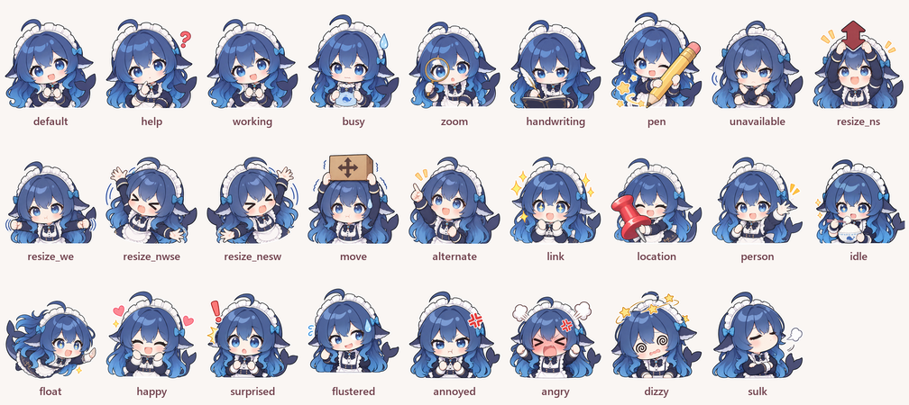

# Mom Pet

[繁體中文](README.md) | [简体中文](README.zh-Hans.md) | [English](README.en.md) | **日本語**

マウスについてくる Windows のデスクトップペットだよ~！カーソルの形が変わると表情も変わって、クリックするとぴょんと跳ねて、何度もクリックすると怒っちゃって、やりすぎると目を回しちゃう！マウスを動かさないと、ひとりでぼーっとし始めるよ。クリックはそのまま通り抜けるから、作業の邪魔はぜんぜんしないよ~

> キャラクターは 3 人入ってるよ：白ごはんが大好きな青い大きな魚 DeepSeek娘、オレンジ色の星をそっと持って考えごとをする Claudeちゃん、それとわたしのオリキャラのハイン！設定画面で切り替えられるよ~

## ダウンロード

[Releases](../../releases) から zip をダウンロードして、展開したら `MomPet.exe` を開くだけ！Windows 10 / 11 ならほかに何もインストールしなくて大丈夫。初めて開いたときに「Windows によって PC が保護されました」と出たら、「詳細情報」を押してから「実行」を押してね~

## どんなことをするの？

**カーソルについてくる**：走る方向に体を傾けて、速く走るほどぺちゃっとつぶれて、止まるとふらっと揺れるよ。マウスを勢いよく振るとふわっと飛んじゃう~

**クリックされると**：1 回クリックするとぴょんと跳ねて、星とハートが飛び出すよ。同じ場所を続けてクリックすると（間隔 0.8 秒以内）、だんだん機嫌が悪くなっていくよ：

| クリック回数 | 表情 |
| --- | --- |
| 1 | うれしい `happy` |
| 3 | びっくり `surprised` |
| 5 | あたふた `flustered` |
| 8 | むっ `annoyed` |
| 11 | おこ `angry`、ぷるぷる震える |
| 16 | 目が回る `dizzy`、ぐるぐる |
| 8 回以上クリックしてからやめる | ちょっとだけすねる `sulk` |

リンクやボタンの上でクリックしたときは、びっくりまでしかいかないから、ふつうにネットを見ていても怒らせたりしないよ~

**ぼーっとする**：マウスを 8 秒動かさないと、自分のことを始めるよ：DeepSeek娘は大きなお茶碗の白ごはんを食べて、Claudeちゃんはオレンジ色の星を持って考えごと、ハインはうとうと居眠りして頭から z が浮かぶよ。マウスを動かすとびくっとしちゃう！

**表情が変わる**：Windows の 16 種類のカーソルにそれぞれ表情があるよ。くるくるのときは忙しそうで、指のときは何かを指さして、禁止マークのときは腕でバツを作るよ~

26 枚ぜんぶはこんな感じ（下の名前が画像パックのファイル名だよ）：

## 設定

右下のタスクトレイにある黄色いネコをクリックすると設定が開くよ！キャラクターの切り替え、一時停止、Windows と一緒に起動、スクリーンショットや録画のときに隠す、マウスがしばらく止まったら消える、大きさの変更（50%～200%）ができて、画面は繁体字中国語・簡体字中国語・英語・日本語から選べるよ。フルスクリーンのゲームやプレゼンのときは自分で隠れてくれるよ~

## 自分のキャラクターにする

背景を透明にした PNG を用意して、設定画面で差し替えるだけ！動く GIF も使えるよ~ `default.png` が 1 枚あれば動くし、絵がない表情はそれで代わりに表示されるよ。ひとそろいを zip にまとめて人にあげることもできて、アニメーションは `idle_1.png`、`idle_2.png` みたいに 1 コマずつ入れられるよ。NovelAI や ChatGPT で表情を全部描きたいときは、[キャラクター画像作成ガイド](docs/角色圖片創作指南.md)（中国語）を見てね。

## クリックエフェクトを自分で作る

クリックエフェクトは数式を書いたテキストファイルだから、プログラムをいじらなくても自分だけのエフェクトが作れるよ~ 2 種類入ってるよ：

書き方はこちら：[クリックエフェクトの説明](docs/點擊特效說明.md)（中国語）

## 自分でビルドする

Windows に入っている .NET Framework 4 だけで大丈夫、Visual Studio はいらないよ。フォルダで `build.cmd` を実行すると `MomPet.exe` ができるよ。実行するときは `assets`、`characters`、`lang`、`effects` の 4 つのフォルダと同じ場所に置いてね。

キャラクターを増やしたいときは、`characters` にフォルダを作って画像を入れて、`character.txt` に名前、作者、大きさ、アニメーションの 1 コマの時間を書いてね。書き方は `src\Characters.cs` のいちばん上にあるよ~

`--settings` を付けると起動してすぐ設定画面が開いて、`--stats` を付けると 5 秒ごとにフレームレートを exe の隣の `stats.log` に書き出すよ。設定は `HKCU\Software\MomPet`、自分の画像とエフェクトは `%LOCALAPPDATA%\MomPet\` に保存されるよ。

## ライセンス

コードは [MIT](LICENSE)、自由に使ってね~

画像（`characters`、`assets`、`docs/media` の中のもの）は [CC BY-NC-SA 4.0](https://creativecommons.org/licenses/by-nc-sa/4.0/)：クレジットを書くこと、商用はダメ、改変したものは同じライセンスで公開してね！

DeepSeek娘はコミュニティの二次創作キャラクターで、DeepSeek の公式設定じゃないよ。原型は上善无形さんの「溟月」、メイド鯨娘は ZipZipPipe さんが描いたものだよ。くわしくは [characters/deepseek/LICENSE.txt](characters/deepseek/LICENSE.txt) を見てね。Claudeちゃんもファンキャラクターで、Anthropic の公式じゃないよ。キャラクターデザインは ZipZipPipe さん、[characters/claude/LICENSE.txt](characters/claude/LICENSE.txt) を見てね。
